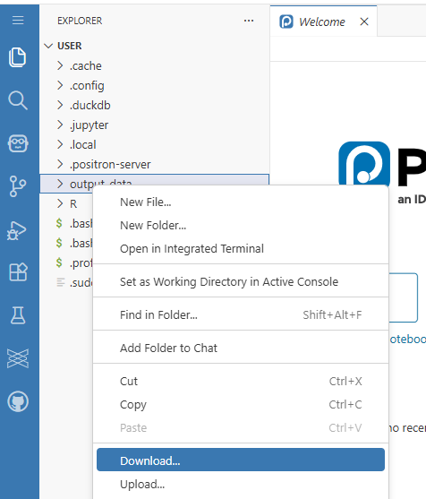
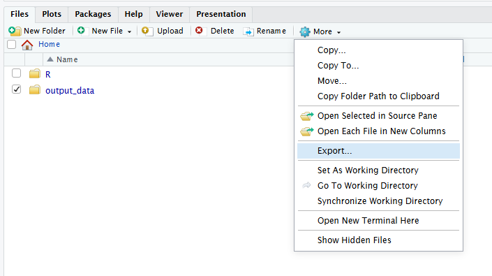

# NOAA Fisheries Cloud Computing Setup

This repository details cloud computing resources at NOAA Fisheries, with a focus on Google Cloud Workstations for R users. Please see the [Openscapes Fall 2025 Cohort's Cloud Clinic](https://gamma.app/docs/Cloud-Clinic-361wjiw6rh2pw2m?mode=doc) for foundational information on cloud data and computing.

## Why Cloud?

All [NOAA datasets must be uploaded in the cloud by 2026](https://docs.google.com/presentation/d/18cwiB2f2rVlX3RJIsIB0iaD9u2bMdblZCS8RYcrGDd0/edit?slide=id.p1#slide=id.p1), and all on-premises computing resources for NOAA Fisheries are planned to be retired by 2027. Working entirely in the cloud allows scientists to make workflows more efficient, without losing time to downloading/uploading. With the transition timeline away from existing resources, we have compiled documentation here to share and allow scientists who previously worked on uber computers to adapt their workflows more quickly.

Google Cloud Workstations act as "uber" computers in the cloud rather than physical machines housed at a NMFS facility. They can be configured and scaled to project-specific needs with massive computational resources (e.g., 16+ vCPUs, 64+ GB RAM) that go far beyond standard laptop capabilities. Any work that previously required uber computers or multiple PCs—such as compute-intensive stock assessments (e.g., WHAM, sdmTMB), spatial movement models, and large simulations—can run for hours or days on a workstation while you retain full functionality of your local PC.

Beyond raw computing power, workstations allow you to work securely from any approved computer without installing heavy analytical software or compilers locally. They also ensure that all team members run the exact same operating system (Ubuntu Linux) and core C/C++ build tools, eliminating environment mismatches across collaborators.

## NOAA Fisheries Cloud Program

[NOAA Fisheries Cloud Program](https://docs.google.com/document/d/1nziPdPULoRWOYQ9WKzISNUgJvANACvfYpFr1z3Ro2Bc/edit?tab=t.0) began a Cloud Compute Accelerator Pilot in early 2025: [Enhancing NOAA Fisheries’ Mission with Google Cloud Workstations](https://docs.google.com/document/d/1u7R5KjfEDYdwYTvO9kU6EyeHfG7dV9TQizIyCn8seO0/edit?tab=t.0). Following the conclusion of this Pilot Program, they compiled [Frequently Asked Questions](https://docs.google.com/document/d/1U1PzGS7G70xsXtD6F6WxkjTSCw7bwNVyZ-YnFyOLOqU/edit?tab=t.0) for pilot participants and new users.

### Terminology and Definitions

Terminology used throughout this tutorial are defined below.

| Term | Definition |
|------------------------------------|------------------------------------|
| Workstation | Pre-configured virtual machines listed under “My Workstations” available on NOAA's Google Cloud. |
| Configuration | The default settings of the workstation including: type (Base, RStudio, Python, posit), and storage/processing size (small, medium, large). |
| Session | An active portion of the workstation, shares storage and power. It is possible to partition a workstation into multiple sessions with different IDEs and core usage. |
| Data Bucket | Cloud-based object storage drive that is optimized for code and external to the workstation. |

### Requesting a Google Cloud Workstation

The NOAA Fisheries Cloud Program grants access to Google Cloud Workstations upon request by filling out the following [form](https://apps-st.fisheries.noaa.gov/jira/servicedesk/customer/portal/14).

When completing the request form:
* **Affiliation:** Select your Science Center or Regional Office (e.g., SWFSC, NEFSC, GARFO, PIRO).
* **Larger Testing Group:** Indicate your cohort if applicable (e.g., *NMFS Open Science Community / Openscapes*).
* **Workstation Type Requested:** Select the environment that matches your workflow (e.g., **Posit Workbench Workstations**, **R Workstations**, or **Python**).
* **Primary Use Case:** Select *Modeling, simulations, and other compute-intensive tasks* and briefly describe your project needs (e.g., WHAM modeling, sardine assessment).

Requests are typically processed within **24 hours**.

## Setting up a Google Cloud Workstation

A Google Cloud Workstation is a virtual machine (VM) that can be customized to mimic any computing environment. The VM is hosted in the cloud and incurs long-term storage costs whether it is in use or not. Ultimately, workstations are designed to be spun up, used, and deleted regularly. Think of workstations as disposable computers, you should strive to get the perfect fit for your purpose, use it, then discard it, with your entire process immortalized on GitHub and your inputs/outputs persisting on cloud storage.

### Selecting the right size workstation

The IDE or program you use to run your code will decide which workstation type you choose (Base, Code OSS, Python, R, Posit Workbench). This section focuses on which size you should choose. High resource users, please see [Fisheries Cloud Program Section 4.0 High-Performance and Custom Workstations (FMC-Funded Option)](https://docs.google.com/document/d/1nziPdPULoRWOYQ9WKzISNUgJvANACvfYpFr1z3Ro2Bc/edit?tab=t.0#heading=h.65j2qoyirqa8): "The enterprise offering is designed to cover standard analytical needs. If your work requires high-cost, specialized resources, such as GPUs, larger machine types (beyond Large), or custom-developed images for specific program workflows, these resources are available, and treated as independent GCP projects, and billed according to the annual GCP cost recovery process."

Standard enterprise workstation configurations include:

- **Small:** 2 vCPU, 8 GB RAM
- **Medium:** 8 vCPU, 32 GB RAM
- **Large:** 16 vCPU, 64 GB RAM

As with previous uber computer work, code should be written and troubleshooted locally before being executed in a workstation. During the troubleshooting process, you should get an idea of what storage and processing requirements you may have via benchmarking. For many processes, a workstation does not need to be a perfect fit, but below are some simple methods for benchmarking your work to better understand which size workstation you should select.

#### Benchmarking Storage Space

The workstation you select will need enough storage to hold all of your inputs, outputs, and temporary files generated during processing. The NOAA Fisheries Cloud Program provides workstations with 10 GB, 50 GB, and 100 GB worth of disk space. You must consider if your process will fit within 100 GB before using a workstation.

Since storage usage scales consistently, you can calculate the total output data by multiplying one unit of output data by however many iterations of code you plan on running. Add that to the total input data, and you know the minimum storage requirements of your process.

If your storage minimum is higher than the "large" workstation configuration (100 GB) then you will need to offload/delete data during the process, use a Google Bucket (see below), or request a custom configuration.

#### Benchmarking Processing Power

The processing power required for a process is more complex than storage space because some code scales with additional CPU and RAM. There are a few key questions you should ask when choosing processing power:

1.  Does the code run in parallel?

    If no, "small" will probably meet your needs unless your code is RAM or storage intensive.

    If yes, select the machine based on how many threads can it use simultaneously.

2.  How long does the process take, and would upgrading improve that time?

    Using the "Wall-Clock" method, you can measure how long 1 iteration takes (`r R:Sys.time()`) and extrapolate that out to however many iterations you plan on running. If your code runs in parallel and improves with additional cores/RAM and you need the results as soon as possible, use the largest machine.

3.  How RAM intensive is the code?

    If your code maxes out the RAM on your local machine, it may be worth it to benchmark your code to better understand how much RAM you will need on a workstation. The R `bench` package or Python `pyperf` can be used to calculate the RAM required.

When in doubt, you can start with the smallest workstation for additional troubleshooting and upgrade as needed.

### Creating and Launching Your Workstation

Once your access ticket is approved, create your workstation in the Google Cloud Console:

1. Log into the Google Cloud Console (link provided in welcome email).
2. In the top search bar, search for and select **Workstations**.
3. Click *Create Workstation* and configure your settings:
   - *Name (ID Field):* **DO NOT modify the auto-generated ID field.** Changing this can cause provisioning or permission errors.
   - *Display Name:* Enter a recognizable name for your project (e.g., `Sardine-Assessment-WS`).
   - *Configuration:* Select your desired workstation type and machine size (Small, Medium, or Large).
4. Click *Create*. Once provisioning finishes, click **Start**, and then click **Launch** to open your IDE (such as RStudio or Posit Workbench) in your browser.

::: {.callout-important title="Mandatory Administrative Rule (OCIO Policy)"}
Users should **NOT** modify the **ID** field when creating a workstation—it is used for administrative tracking and billing. You may modify the **Display Name** to follow your preferred naming convention. OCIO periodically reviews workstation IDs and deletes any that do not conform to the default ID naming convention.
:::
   
## Using a Workstation

**BACK UP YOUR WORK** and use the cloud workstations to run existing scripts, not to develop code. Hourly compute costs are incurred when the workstation has been "Started", so ensure that each workstation is "Stopped" when runs are complete and the computing session is no longer in use. Be aware that these workstations automatically delete after 6 months of no use to avoid long term storage costs. The optimal workflow for a workstation is to have a GitHub repository with all the necessary code to run your process. Thus, the first step when opening a workstation should be connecting to GitHub.

### Storage Realities: Persistent vs. Ephemeral

Understanding how cloud storage is structured is vital to preventing data loss:

| Storage Category | Target Directory | Storage Lifetime | Key Usage & Policies |
| :--- | :--- | :--- | :--- |
| **Persistent Storage** | `/home/user/` | **For life of workstation** | Your personal home directory. All scripts, Git repositories, settings (`~/.Renviron`, `~/.git-credentials`), and user R package libraries saved here survive VM reboots and session restarts. |
| **Ephemeral Storage** | `/usr/`, `/etc/`, `/tmp/` | **Temporary** | The container's root system paths. Any modifications made outside `/home/user/` are wiped whenever administrators recreate or update the workstation container image. |
| **Isolated Instances** | Container Disk | **Isolated** | Each user operates inside their own isolated VM. You **cannot** mount or cross-share local hard drive paths directly between user containers. Team sharing relies on GitHub and `renv`. |

### Permission Boundaries

As a workstation user, you have administrative (`sudo`) privileges **inside your assigned container shell**, allowing you to install Linux operating system libraries and headers. However, you **do not** have access to the central Google Cloud infrastructure, underlying Dockerfiles, or Docker daemons managed by NOAA OCIO.

### Linking Workstation to GitHub

The quickest and most persistent method for linking a workstation to a Github Enterprise Account is with a Personal Access Token (PAT). This can be done by reading the instructions and executing the code in [R/github_setup.R](https://github.com/nmfs-opensci/CloudComputingSetup/blob/main/R/github_setup.R). Before executing the script you will need to generate a PAT, bellow are relevant PAT documentation (also linked in script):

1.  [GitHub PAT Settings](https://github.com/settings/tokens)
2.  [GitHub PAT Tutorial](https://docs.github.com/en/authentication/keeping-your-account-and-data-secure/managing-your-personal-access-tokens)
3.  [NMFS GitHub Governance Authentication Tutorial Video](https://drive.google.com/file/d/1tbbw_xXARK689Zj5tm4lVo18aBaXhdKX/view?t=4) (Requires NOAA Google Drive access)

Workstations will remain linked to GitHub until the PAT expires and persists even if the workstation is shutdown. Once the link is made to your GitHub repository, you can push and pull changes as you would from any other machine.

#### Additional Notes on PATs

[Personal access tokens (classic)](https://docs.github.com/en/authentication/keeping-your-account-and-data-secure/managing-your-personal-access-tokens#personal-access-tokens-classic) are less secure. However, classic tokens can be used across multiple repositories and are simpler to setup. If you are a beginner using PATs, we recommend generating a classic token with only 'repo' access granted in the scope.

PATs should be set to expire in 90 days. 'Configure SSO' needs to be set to 'Authorize' access to your Enterprise organization if applicable, e.g. SEFSC.

### Customizing Your Configuration

Code generally requires a specific computing environment to work properly, this is especially important when treating workstations as temporary machines. Below are some best practices for ensuring your environment is set-up before running your code.

We have provided 2 examples for installing packages. The [easy package install](https://github.com/nmfs-opensci/CloudComputingSetup/blob/main/R/package_install_easy.R) example lists typical install.package() functions with a few specialized lines for installing specific versions of packages. For simple scripts with limited package installations, this is an easy way to maintain scripts for new users. The [intermediate package install](https://github.com/nmfs-opensci/CloudComputingSetup/blob/main/R/package_install_intermediate.R) example has the basic commands required for building, restoring, and maintaining a R:renv environment. This R package saves your R package environment as a renv.lock file which can be stored in github and used to create the same environment on any machine. This method works will if your processes require a lot of packages with specific versions but it can be trickier to get working and maintain. Both examples include the RStudio fix described below and create files for input and output data that can serve as bucket mount points.

#### RStudio

By default the RStudio configuration will attempt to download packages via source code instead of binary through the posit package manager which drastically slows the installation progress down. When configuring your environment in RStudio, you will switch between two primary tabs in the lower-left panel:

| Tab Name | Prompt Symbol | Primary Purpose | Example Tasks |
| :--- | :---: | :--- | :--- |
| **R Console** | `>` | Runs interactive R code and scripts | Executing models, inspecting objects, running `pak` or `renv::restore()` |
| **Bash Terminal** | `$` | Runs Linux operating system commands | Installing OS packages (`sudo apt-get`), file management, `git` operations |

##### Configuring Binary Package Downloads

Before starting any installations, in the **R Console** (`>`), run the following code to source pre-compiled Ubuntu Linux binaries:

```{r}
repo_line <- 'options(repos = c(CRAN = "https://packagemanager.posit.co/cran/__linux__/jammy/latest"))'
writeLines(repo_line, "~/.Rprofile")
# Restart R session to lock in Rprofile changes
# Session -> Restart R or Ctrl+Shift+F10
```
You must restart the RStudio's R session before you install any packages. This should allow your workstation to install packages just as fast as a Posit configuration.

##### Configuring Persistent R Library Paths

Unlike the Posit configuration—which prompts you to create a personal package directory on first install—RStudio users should verify that package installations target their persistent home directory (`/home/user/`) so libraries survive workstation restarts.

In the R Console (`>`), inspect your current library search paths:

```{r}
.libPaths()
```
If a user path under `/home/user/R/x86_64-pc-linux-gnu-library/` (e.g., .../4.6) is missing, create it and register it in `~/.Renviron` via the Bash **Terminal** tab (`$`):

Then restart your R session (Session -> Restart R) and re-run `.libPaths()` to confirm the persistent directory appears first.

##### Sanitizing the System *Renviron* File

In certain workstation container images, system environment variables (such as `DOCKER_OPTS` or `HOSTNAME`) can get appended to the system-level Renviron file, causing syntax errors in subshell calls like `R CMD INSTALL`.

Run the following commands in the Bash **Terminal** tab (`$`):

```{bash}
# Truncate /usr/lib/R/etc/Renviron at the standard terminal delimiter
sudo sed -i -n '1,/### End: \*\*\*/p' /usr/lib/R/etc/Renviron

# Verify the file ends cleanly
tail -n 8 /usr/lib/R/etc/Renviron

# Verify R's compiler toolchain
R CMD config
```

#### Posit

The Posit configuration is the easiest environment to set-up, whether you are using the Positron or RStudio IDE. Since Posit uses the posit package manager by default, any packages you install via install.packages() should install quickly and easily. When installing the first package you will be prompted to create a personal folder for the packages to be stored in home/user, you should type "yes" twice and that will ensure that your packages will persist between opening and closing the workstation.

#### Installing OS-Level System Dependencies (Why `install.packages()` Fails)

Unlike Windows or macOS, Ubuntu Linux does not bundle external C/C++ libraries inside R packages. Analytical and data-wrangling packages such as `sf`, `terra`, `stars`, `ncdf4`, `sdmTMB`, `wham`, and `tidyverse` rely on underlying Linux system libraries (`GDAL`, `GEOS`, `PROJ`, `NetCDF`, `HDF5`, `UDUNITS`, `cURL`, `OpenSSL`, and `libxml2`).

Running `install.packages()` directly for these packages often fails with compilation errors for two reasons:

1. **System directory location:** Compiled C/C++ binaries and header files must live in root system folders (`/usr/include` and `/usr/lib`), outside your `/home/user/` directory.
2. **Permission boundaries:** R's `install.packages()` can only write to R library folders—it cannot modify system directories or invoke Linux's package manager.

Before installing packages in R, install these core OS-level headers in the **Bash Terminal** tab (`$`) using superuser (`sudo`) privileges:

```{bash}
sudo apt-get update && sudo apt-get install -y \
  libudunits2-dev \
  libgdal-dev \
  libgeos-dev \
  libproj-dev \
  libnetcdf-dev \
  libhdf5-dev \
  libcurl4-openssl-dev \
  libssl-dev \
  libxml2-dev

# Verify system compilers are recognized
gdal-config --version
nc-config --version
```

#### Fast Package Management with `pak`

While `install.packages()` works for simple scripts, `pak` is recommended for complex analytical workflows on cloud workstations because it:

1. *Resolves dependencies in parallel:* Downloads and installs packages concurrently, drastically reducing setup time.
2. *Avoids partial/broken installs:* Solves the entire dependency tree before installing anything, preventing version conflicts mid-install.
3. *Unifies CRAN and GitHub installations:* Handles pre-compiled Ubuntu Linux binaries from Posit Public Package Manager (PPM) alongside GitHub-hosted models (such as `wham`) in a single workflow.

In the **R Console** (`>`), install `pak`, point R to Posit Package Manager binaries, and batch-install your analytical stack:

```{r}
# 1. Install pak
install.packages("pak", repos = "[https://cloud.r-project.org](https://cloud.r-project.org)")

# 2. Point R to pre-compiled Ubuntu Linux binaries on Posit Package Manager
options(repos = c(CRAN = "[https://packagemanager.posit.co/cran/__linux__/jammy/latest](https://packagemanager.posit.co/cran/__linux__/jammy/latest)"))

# 3. Batch install CRAN packages (replace with your project's packages)
pkgs <- c(
  "fs", "ncdf4", "s2", "units", "terra", "sass", "bslib",
  "sf", "gargle", "rmarkdown", "stars", "googledrive",
  "reprex", "googlesheets4", "fmesher", "sdmTMB", "tidyverse"
)
pak::pkg_install(pkgs)

# 4. Install GitHub-hosted packages (e.g., WHAM or Stock Synthesis r4ss)
github_pkgs <- c("timjmiller/wham", "r4ss/r4ss")
pak::pkg_install(github_pkgs)
```

Verify that your spatial and modeling libraries load cleanly:

```{r}
# Load libraries (replace with your project's packages)
library(ncdf4)
library(sf)
library(terra)
library(sdmTMB)
library(wham)
```
#### Known Package Conflicts on Cloud Workstations

When combining spatial, stock assessment, and ´tidyverse´ packages on Ubuntu Linux, watch out for these common issues:

´tidyverse´ (´xml2´, ´curl´, ´httr´) and ncdf4 compilation failures: Even meta-packages like ´tidyverse´ fail during source builds if ´libxml2-dev´, ´libcurl4-openssl-dev´, or ´libssl-dev´ are missing, while ´ncdf4´ requires ´libnetcdf-dev´ and ´libhdf5-dev´. Installing the OS headers above prevents these errors, and using pak automatically pulls pre-compiled Linux binaries when available.

Matrix and TMB-based packages (´sdmTMB´, ´wham´, ´glmmTMB´): If ´Matrix´ or ´TMB´ is updated independently, downstream modeling packages may fail with C++ ABI or SuiteSparse mismatch errors. Fix this by reinstalling the affected modeling package (´pak::pkg_install("sdmTMB", upgrade = TRUE)´) or restoring a pinned ´renv.lock´ file.

GitHub package dependencies (´r4ss´, ´wham´): Stock assessment packages hosted on GitHub often depend on specific CRAN versions or suggest packages that fail if installed sequentially. Installing them via ´pak::pkg_install("r4ss/r4ss")´ resolves both CRAN and GitHub dependencies in a single pass.

Function namespace masking: Loading modeling and spatial libraries alongside ´tidyverse´ commonly masks core functions—most notably ´MASS::select()´ masking ´dplyr::select()´, and ´terra::extract()´ masking ´tidyr::extract()´. Use explicit namespace prefixes (e.g., ´dplyr::select()´) in shared scripts.

#### Troubleshooting Package Installations

If an installation times out or fails to compile, residual lock files or incomplete folders can block subsequent package installations.

##### 1. Missing OS Header Libraries

If compilation fails with `configuration failed for package 'X'` or `header file not found`, check the error message for the missing Linux library name (e.g., `libxml-2.0` or `openssl`), and install the corresponding `-dev` package in the **Bash Terminal** tab (`$`):

```{bash}
sudo apt-get update && sudo apt-get install -y libxml2-dev libssl-dev
```

Then retry the installation in the **R Console** (`>`):

```{r}
pak::pkg_install("package_name")
```

##### 2. Remove Stale Lock Files (`00LOCK`)

If an interrupted installation leaves behind a lock directory, clear it in the **Bash Terminal** tab (`$`) (adjust the R version number if needed):

```{bash}
rm -rf /home/user/R/x86_64-pc-linux-gnu-library/4.6/00LOCK*
```

##### 3. Clean Incomplete Package Builds

Run this diagnostic script in the **R Console** (`>`) to identify and delete corrupted package folders missing a valid `DESCRIPTION` file:

```{r}
lib <- "/home/user/R/x86_64-pc-linux-gnu-library/4.6"
dirs <- list.dirs(lib, full.names = TRUE, recursive = FALSE)

# Identify folders missing DESCRIPTION metadata
broken <- dirs[!file.exists(file.path(dirs, "DESCRIPTION"))]

if (length(broken) > 0) {
  unlink(broken, recursive = TRUE)
  message("Removed incomplete package folders: ", paste(basename(broken), collapse = ", "))
} else {
  message("No broken package folders found.")
}
```
#### Environment Replication with `renv`

Rather than relying on costly VM cloning to replicate setups across machines or collaborators, use **`renv`** alongside GitHub to lock and share exact R package versions without version drift. *(For a starter script template, see [R/package_install_intermediate.R](https://github.com/nmfs-opensci/CloudComputingSetup/blob/main/R/package_install_intermediate.R]).*

| Workflow Phase | Responsible Party | Primary Command / Action | Output Artifact |
| :--- | :--- | :--- | :--- |
| 1. Initialize Tracking | Lead Developer | `renv::init(bare = TRUE)` | `.Rprofile`, `renv/activate.R` |
| 2. Snapshot Dependencies | Lead Developer | `renv::snapshot(type = "all")` | `renv.lock` JSON file |
| 3. Push Blueprint | Lead Developer | `git push origin main` | Pushed repository with lockfile |
| 4. Mirror Environment | Collaborators | `renv::restore()` | Reconstructed persistent library |

##### 1. Initialize `renv` and Take a Snapshot

In the **R Console** (`>`):

```{r}
# 1. Install renv if missing
if (!requireNamespace("renv", quietly = TRUE)) {
  install.packages("renv", repos = "[https://cloud.r-project.org](https://cloud.r-project.org)")
}

# 2. Initialize project tracking
renv::init(bare = TRUE)

# 3. Snapshot current package environment to the lockfile
renv::snapshot(type = "all")
```

##### 2. Configure `.gitignore` and Push the Lockfile

Verify .gitignore in the Bash **`Terminal`** tab ($) to ensure large binary library folders are excluded from Git tracking:

```{bash}
cat .gitignore
```

Confirm that your `.gitignore` includes:
```{Plaintext}
.Rproj.user/
.Rhistory
.RData
.Ruserdata
renv/library/
renv/local/
renv/staging/
```

Commit and push the lockfile and project settings in the Bash **`Terminal`** tab (`$`):

```{bash}
git add .Rprofile renv.lock renv/activate.R renv/settings.json .gitignore
git commit -m "Initialize renv package dependency lockfile"
git push
```

##### 3. Robust Project Setup & Fallback Script

For scripts that need to run across team workstations regardless of whether `renv::restore()` encounters network glitches or binary mismatches, include this initialization pattern at the top of your analysis scripts (customize `required_cran` and `required_github` for your project):

```{r}
# Setup & Dependency Configuration

# 1. Attempt environment restoration via renv lockfile
restore_successful <- tryCatch({
  message("Restoring packages via renv lockfile...")
  renv::restore(prompt = FALSE)
  TRUE
}, error = function(e) {
  warning("renv::restore() failed or is out of sync. Falling back to pak...")
  FALSE
})

# 2. Fallback installer: Run only if renv::restore failed or packages are missing
# Replace with your project's CRAN and GitHub packages
required_cran   <- c("tidyverse", "here", "ncdf4", "sf")
required_github <- c("timjmiller/wham", "r4ss/r4ss") # Set to character(0) if none needed

missing_cran     <- required_cran[!sapply(required_cran, requireNamespace, quietly = TRUE)]
github_pkg_names <- basename(required_github)
missing_github   <- required_github[!sapply(github_pkg_names, requireNamespace, quietly = TRUE)]

if (length(missing_cran) > 0 || length(missing_github) > 0) {
  # Point R to pre-compiled Ubuntu Linux binaries on Posit Package Manager
  options(repos = c(CRAN = "[https://packagemanager.posit.co/cran/__linux__/jammy/latest](https://packagemanager.posit.co/cran/__linux__/jammy/latest)"))

  if (!requireNamespace("pak", quietly = TRUE)) {
    message("Installing pak...")
    install.packages("pak", repos = "[https://cloud.r-project.org](https://cloud.r-project.org)")
  }

  if (length(missing_cran) > 0) {
    message("Installing missing CRAN packages: ", paste(missing_cran, collapse = ", "))
    pak::pkg_install(missing_cran)
  }

  if (length(missing_github) > 0) {
    message("Installing missing GitHub packages: ", paste(missing_github, collapse = ", "))
    pak::pkg_install(missing_github)
  }
}

message("All dependencies verified!")
```
# 3. Load libraries safely

```{r}
library(YourPackageHere)
```

##### 4. Teammate Quickstart: Mirroring the Environment

Collaborators joining an existing project can replicate the complete analytical environment in three steps:

1. Install OS system headers in the Bash **`Terminal`** tab (`$`):

```{bash}
sudo apt-get update && sudo apt-get install -y \
  libudunits2-dev libgdal-dev libgeos-dev libproj-dev libnetcdf-dev
```

Clone the project in RStudio: Navigate to File -> New Project... -> Version Control -> Git, enter the repository URL, and authenticate with your GitHub Personal Access Token (PAT).

Restore the R package environment in the R Console (>):

```{r}
renv::restore()
```
#### Daily `renv` & Git Collaboration Commands
| Goal / Workflow Task | Interface | Target Function / Command | Expected Outcome | 
| :--- | :--- | :--- | :--- | 
| Save new packages to lockfile | **`Console`** (`>`) | renv::snapshot() | Updates renv.lock with latest installed versions | 
| Pull latest project updates | **`Terminal`** (`$`) | git pull | Fetches code and lockfile changes from GitHub |
| Sync local library to lockfile | **`Console`** (`>`) | renv::restore() | Installs exact lockfile package versions locally |
| Check environment sync status | **`Console`** (`>`) | renv::status() | Reports whether local library matches renv.lock |

### Cloning Your Workstation

Best Practices for configuring workstations is still in development. A current strategy for repeated similar runs includes cloning your workstation. This solution involves an underlying workstation storage cost (cheaper than run times, but still cost inefficient). Ideally, we would have workstation templates that require minimal additional configurations, avoiding this burden and associated storage cost. Base workstations for cloning should be utilized short term and should only be stored if you're running repeated similar tasks at the same time. All workstations (including the base) should be deleted when the task is completed.

### Running Code

In workstations, a key benefit is being able to start code running and walk away until it finishes. You do this by running your code in the Posit Workbench or R Background Jobs. This means you need to build your scripts in such a way that no user interaction is required (i.e. confirmations y/n or authentication). Any authentication or package installation should be done with you actively there, then you can run your totally independent code.

### Downloading Data

When your run is complete, best practices would be to produce your output reports in the cloud as well, using quarto documents stored on Github. But if you need to download data from a workstation you can manually download it with the IDE's manual download methods.

**Positron**: right click on the file and download it, positron will then prompt you to choose the file you want to download it to. There will be a moving blue bar above the file explorer that will stop moving when the download is complete.

{width="326"}

**RStudio**: press the check-mark box next to a file and press the cog drop down to select download. This will compress the file and download it as a zip. This will open a new blank browser while it downloads, when the download is finished the window will close itself and the browser will show the file in your downloads.

{width="522"}

## Requesting a Google Data Bucket

Work through local IT to obtain a data bucket **in the us-east4** region. Permissions to read and write to these data buckets can only be granted through IT admin. Reference existing [documentation about servers vs objects](https://nmfs-opensci.github.io/EDMW-EarthData-Workshop-2025/content/why-cloud.html) for additional information on Google shared drive vs data buckets and relative speed. Currently, there is no existing link between Google Shared Drive and Google Cloud Workstations.

Existing public NOAA data buckets can be found [here](https://www.noaa.gov/nodd/datasets#NMFS) for reference as to what these data buckets look like in the web interface. Instructions provided here are for use cases where the user has both read and write access to the data bucket being mounted, but mounting a public database should work similarly (sans write access).

Note, the Google Workstations are in the us-east4 region. It is important that your Google Bucket is in the same region so that there are no data movement changes. If your bucket is not in Google region us-east4, there is a data movement charge both to OCIO and to your local FMC. Your FMC will be charged egress charges for any data that is downloaded to or read into the workstation and OCIO gets charged for data going from the workstation in us-east4 to a bucket in another Google region (not us-east4). Cost is about $0.02/Gb for both ingress and egress. Note this is true for public buckets like NOAA NOAA buckets. You will pay to put data there if you are processing in a virtual machine; you will not pay if you process on your local computer and upload to Google Buckets.

## Linking Workstation to Bucket

Buckets need to be mounted each time a workstation is started and should persist across all sessions until the workstation is turned off. Mounting a bucket requires an active terminal (the tab next to the R console in RStudio and Positron). Copy and paste the [R/mount_bucket.R](https://github.com/nmfs-opensci/CloudComputingSetup/blob/main/R/mount_bucket.R) code directly in the terminal. [Please note that ctrl+v does not work for pasting into an R terminal; ctrl+shift+v or manually right click and select 'Paste'. ] The code is commented with instructions and can be pasted line by line or all at once.

The terminal will prompt you to authenticate your google account on [line 17](https://github.com/SEFSC/cloud_computing_SSMSE_starter/blob/0d3689835cd279d37bf01e47fe8b7ba8e426b485/mount_bucket.R#L17):

```{r}
gcloud auth application-default login --no-launch-browser
```

Follow the prompts to authenticate (including pasting the output from your browser directly into Terminal), then press enter or copy and paste the rest of the script in the R Terminal to continue the process. This is the most finicky and potentially user-specific step of the process. The remaining code will install or update `gcsfuse` on the workstation and mount the bucket. Once mounted a first time, lines 41-47 can be used to remount a bucket after a workstation is shutdown and skip the authentication/installation process.

*We'll need to change the bucket name to the public one that Eli plans to use for Openscapes/training purposes*

### Validating the Connection

From the code provided previously to mount a data bucket, we have named the bucket `my_gsc_bucket` and stick with this nomenclature throughout. If you are still working in the R Terminal, you can validate the connection using

`ls -l "$MOUNT_POINT"`

If you are working in a regular R Script or Console, you can check the contents of the bucket using

`list.files("~/my_gcs_bucket")`

Additionally, to view contents within subfolders, you can use

`list.files(path = "~/my_gcs_bucket/subfolder")`

Please note that within an RStudio cloud interface, the 'Files' GUI typically located in the lower right-hand corner may show an empty `$HOME/my_gsc_bucket` folder, but running the scripts above will verify if the data bucket has been successfully mounted.

### Reading from Buckets

Once the connection to the Data Bucket is made, you can run [R scripts](https://github.com/nmfs-opensci/CloudComputingSetup/blob/main/R/readwrite_databucket.R) as usual, pointing to the bucket location. For example,

`load('~/my_gcs_bucket/subfolder/sampdata1.RData')`

`data <- read.csv("~/my_gcs_bucket/subfolder/sampdata2.csv")`

both work to load an RData image and .csv file, respectively.

### Writing to Buckets

Writing to buckets works similarly. If the 'data' file above was cleaned on the Workstation and named 'data2' in R, this could be written directly to the workstation as 'sampdata2_clean.csv'.

`write.csv(data2,"~/my_gcs_bucket/subfolder/sampdata2_clean.csv")`

### Downloading from Buckets

Data can be downloaded to a local machine manually by opening the bucket in a browser, clicking download, and selecting the files you want to download.

If you are moving large amounts of data and need to automate the process, follow these instructions:

1.  You need to install the Google cloud CLI plus python on the machine you want to download the data on: <https://cloud.google.com/sdk/docs/install>

2.  Upon installation, the Google Cloud SDK will walk you through authenticating your Google account so it can access any buckets you have access to.

3.  It will prompt you to select a NMFS project.

4.  Use bash code i.e. `cd /d/User/my_name/my_file/` to navigate to the folder where you want the data to go.

5.  Then run with the path to the bucket file you want to download example:

 `gsutil -m cp -r "gs://name_of_bucket/file_within_bucket"`

### Best Practices

Best Practices are still under development. Authors are considering options such as defining 'cloud' file paths and 'local' file paths for reading and writing data that are called at the top of the scripts, allowing for minimal edits between programs that are run in the cloud and locally. Alternatively, programs could be written exclusively for cloud computing platforms or local computing.

Suggested ways to set up workflows to easily move between running locally and in the cloud if desired?

General Tips:

-   Code should be on Github.

-   Large data should be stored in Google Cloud Buckets.

-   R Projects can be saved as a Github Repositories and automatically set the working directory to the cloned repository on your local machine and workstation.

-   Use .gitignore on your "input" and "output" files but include code in your workstation starter to create "input" and "output" folders in the workstation so you can import your data or mount your bucket to the same location in your working directory every time.

-   Talk to your colleagues to see how they set up their scripts, start to use the same formats, and share github repositories.

-   Google Shared Drives cannot connect to Google Cloud Workstations currently. Any actively used data will need to be moved manually or to a Google Cloud Bucket.

## Alternative Options

If cloud computing resources are not necessary, alternative options include accessing data in the cloud with local computing resources. With Google Drive for Desktop, data on shared drives can be accessed using G:/ the same as we access shared drives on local computers. Alternatively, if cloud computing workstations have sufficient storage for the programs that you're running, it is not absolutely necessary to link to a data bucket.

## Acknowledgements

Resources shared by [Eli Holmes](https://github.com/eeholmes), [Jonathan Peake](https://github.com/jonpeake), Josh Lee, and Ed Rogers; authored by [Alex Norelli](https://github.com/norellia-NOAA), [Molly Stevens](https://github.com/mollystevens-noaa), and [Stephanie Hopkins](https://github.com/ScHopkins2025).

### Disclaimer

This repository is a scientific product and is not official communication of the National Oceanic and Atmospheric Administration, or the United States Department of Commerce. All NOAA GitHub project content is provided on an ‘as is’ basis and the user assumes responsibility for its use. Any claims against the Department of Commerce or Department of Commerce bureaus stemming from the use of this GitHub project will be governed by all applicable Federal law. Any reference to specific commercial products, processes, or services by service mark, trademark, manufacturer, or otherwise, does not constitute or imply their endorsement, recommendation or favoring by the Department of Commerce. The Department of Commerce seal and logo, or the seal and logo of a DOC bureau, shall not be used in any manner to imply endorsement of any commercial product or activity by DOC or the United States Government.

### License

This content was created by U.S. Government employees as part of their official duties. This content is not subject to copyright in the United States (17 U.S.C. §105) and is in the public domain within the United States of America. Additionally, copyright is waived worldwide through the CC0 1.0 Universal public domain dedication.
